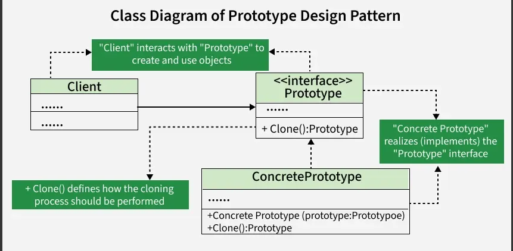
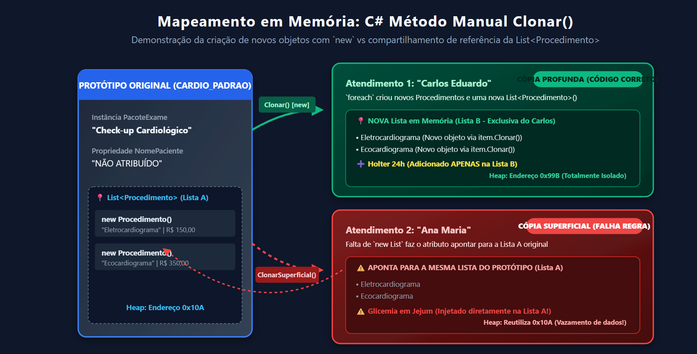

## 🚀 Guia Prático: Design Patterns C# - IMPLEMENTAÇÃO DO PATTERN PROTOTYPE NA CLÍNICA MÉDICA

### 📌 Contexto do Projeto: Sistema Interno da Clínica "Vida & Saúde"

Em sistemas de gestão hospitalar e clínica, é comum a criação recorrente de objetos complexos com configurações padronizadas. Criar esses objetos do zero instanciando todas as propriedades repetidamente pode gerar código redundante e gargalos de processamento.

Nesta atividade, você desenvolverá uma aplicação Console em C# (.NET 9) aplicando o padrão de projeto Prototype de forma 100% manual. Criaremos nossos próprios métodos para copiar os objetos, instanciando novas classes diretamente com o operador new para entender perfeitamente o que acontece na memória do computador.

 

### 💼 Regra de Negócio: O Problema dos Check-ups e Protocolos Médicos
A clínica "Vida & Saúde" oferece pacotes de exames padronizados (ex: Check-up Cardiológico Geral, Check-up Admissional, Rotina Pediatria). Cada pacote possui um conjunto fixo de procedimentos, orientações prévias e valores base.

1. Agilidade no Atendimento: Em vez de configurar individualmente cada solicitação de exame com suas dezenas de instruções (ex: "Jejum de 8h", "Chegar 15 min antes"), o atendente deve clonar um pacote modelo já cadastrado.

2. Customização Individual: Após a clonagem, o atendente pode personalizar o nome do paciente e adicionar ou remover exames sem alterar o pacote modelo original.

3. Cópia Superficial vs. Cópia Profunda (Shallow vs. Deep Copy): As solicitações contêm uma lista interna de procedimentos. Se duplicarmos apenas o pacote mas compartilharmos a mesma lista, ao alterar os exames de um paciente, alteraremos o modelo base. Precisamos aprender a fazer uma Cópia Profunda (Deep Copy) instanciando novos objetos e uma nova lista do zero.

 


### 🛠️ Pré-requisitos

- Visual Studio 2022 ou VS Code (com .NET 9 SDK instalado)

- Conhecimentos básicos de POO em C# (Classes, Construtores, Listas e foreach)

### 🎯 Objetivos de Aprendizagem

1. Compreender o Pattern Prototype: Entender quando e por que clonar objetos existentes.

2. Criar Métodos Manuais de Clonagem: Entender que clonar é simplesmente instanciar um novo objeto (new) e copiar seus valores.

3. Diferenciar Cópia Superficial e Profunda: Compreender a diferença entre copiar um endereço de memória de uma lista e criar uma lista totalmente nova.

4. Gerenciar Protótipos em Memória: Criar um registro centralizado (Prototype Registry) usando Dicionários (Dictionary<TKey, TValue>)

## 📋 Atividade Prática: Passo a Passo

### 📂 Etapa 1: Criando a Classe Procedimento
### Subtarefa 1.1: Criar a classe Procedimento
Crie o arquivo Procedimento.cs na pasta Models. Adicionaremos um método manual chamado Clonar() que retorna um novo Procedimento.

```csharp

namespace ClinicaPOO.Models
{
    public class Procedimento
    {
        public string Nome { get; set; }
        public decimal Valor { get; set; }

        public Procedimento(string nome, decimal valor)
        {
            Nome = nome;
            Valor = valor;
        }

        // Clonagem Manual: Criamos uma NOVA instância usando 'new' com os mesmos dados
        public Procedimento Clonar()
        {
            Procedimento novoProcedimento = new Procedimento(this.Nome, this.Valor);
            return novoProcedimento;
        }
    }
}

```

### 📂 Etapa 2: Implementando a Classe PacoteExame
### Subtarefa 2.1: Criar a classe PacoteExame

Crie o arquivo PacoteExame.cs na pasta Models. Aqui implementaremos manualmente a Cópia Profunda (Deep Copy) e a Cópia Superficial (Shallow Copy) para comparar seus comportamentos.

```csharp
using System;
using System.Collections.Generic;

namespace ClinicaPOO.Models
{
    public class PacoteExame
    {
        public string NomePacote { get; set; }
        public string OrientacoesJejum { get; set; }
        public string NomePaciente { get; set; }
        public List<Procedimento> Procedimentos { get; set; }

        public PacoteExame(string nomePacote, string orientacoesJejum)
        {
            NomePacote = nomePacote;
            OrientacoesJejum = orientacoesJejum;
            NomePaciente = "NÃO ATRIBUÍDO";
            Procedimentos = new List<Procedimento>();
        }

        public void AdicionarProcedimento(Procedimento procedimento)
        {
            Procedimentos.Add(procedimento);
        }

        // 1. CÓPIA PROFUNDA (DEEP COPY) - O Jeito Correto!
        // Instancia um novo pacote E uma nova lista com novos procedimentos clonados
        public PacoteExame Clonar()
        {
            // Criamos um novo pacote na memória usando 'new'
            PacoteExame pacoteClonado = new PacoteExame(this.NomePacote, this.OrientacoesJejum);
            pacoteClonado.NomePaciente = this.NomePaciente;

            // Percorremos a lista original e clonamos item por item para a nova lista
            foreach (Procedimento item in this.Procedimentos)
            {
                Procedimento itemCopia = item.Clonar(); // Instancia um novo procedimento
                pacoteClonado.Procedimentos.Add(itemCopia);
            }

            return pacoteClonado;
        }

        // 2. CÓPIA SUPERFICIAL (SHALLOW COPY) - Apenas para entender o Erro
        // Copia apenas o pacote, mas aponta para a MESMA lista de procedimentos na memória
        public PacoteExame ClonarSuperficial()
        {
            PacoteExame pacoteRaso = new PacoteExame(this.NomePacote, this.OrientacoesJejum);
            pacoteRaso.NomePaciente = this.NomePaciente;
            
            // PERIGO: Não criamos uma nova lista, reutilizamos a mesma referência!
            pacoteRaso.Procedimentos = this.Procedimentos; 

            return pacoteRaso;
        }

        public void ExibirResumo()
        {
            Console.WriteLine($"\n[PACOTE]: {NomePacote} | Paciente: {NomePaciente}");
            Console.WriteLine($"  Orientação: {OrientacoesJejum}");
            Console.WriteLine("  Procedimentos inclusos:");
            decimal total = 0;
            foreach (var p in Procedimentos)
            {
                Console.WriteLine($"   - {p.Nome}: R$ {p.Valor:F2}");
                total += p.Valor;
            }
            Console.WriteLine($"  Total: R$ {total:F2}");
        }
    }
}

```

### 📂 Etapa 3: Gerenciador de Protótipos (Prototype Registry)
### Subtarefa 3.1: Criar a classe GerenciadorPrototipos
Crie o arquivo GerenciadorPrototipos.cs na pasta Services. Esta classe serve como um "catálogo" central onde os modelos ficam guardados para serem clonados a qualquer momento.


```csharp
using System.Collections.Generic;
using ClinicaPOO.Models;

namespace ClinicaPOO.Services
{
    public class GerenciadorPrototipos
    {
        // Dicionário para guardar os protótipos modelo (Chave = Nome do Modelo, Valor = PacoteExame)
        private Dictionary<string, PacoteExame> _prototipos = new Dictionary<string, PacoteExame>();

        public void CadastrarPrototipo(string chave, PacoteExame prototipo)
        {
            _prototipos[chave] = prototipo;
        }

        public PacoteExame ObterClone(string chave)
        {
            if (_prototipos.ContainsKey(chave))
            {
                // Busca o modelo original e chama o nosso método Clonar() manual
                PacoteExame modeloOriginal = _prototipos[chave];
                return modeloOriginal.Clonar();
            }

            return null;
        }
    }
}

```

---

### 📂 Etapa 4: Executando e Testando a Aplicação (Program.cs)
### Subtarefa 4.1: Código do Program.cs

```csharp
using System;
using ClinicaPOO.Models;
using ClinicaPOO.Services;

Console.WriteLine("=== SISTEMA DA CLÍNICA VIDA & SAÚDE - PATTERN PROTOTYPE ===\n");

GerenciadorPrototipos gerenciador = new GerenciadorPrototipos();

// 1. CONFIGURAÇÃO DOS MODELOS BASE (Protótipos)
PacoteExame checkupCardio = new PacoteExame("Check-up Cardiológico", "Jejum de 8h e evitar cafeína");
checkupCardio.AdicionarProcedimento(new Procedimento("Eletrocardiograma", 150.00m));
checkupCardio.AdicionarProcedimento(new Procedimento("Ecocardiograma", 350.00m));

// Cadastra o modelo no gerenciador
gerenciador.CadastrarPrototipo("CARDIO_PADRAO", checkupCardio);

Console.WriteLine("--- Modelo Base Cadastrado ---");
checkupCardio.ExibirResumo();

// 2. USO CORRETO: Clonando via Cópia Profunda (Deep Copy)
Console.WriteLine("\n------------------------------------------------");
Console.WriteLine("--> Atendimento 1: Clonando modelo base via Clonar() [Deep Copy]");

PacoteExame atendimento1 = gerenciador.ObterClone("CARDIO_PADRAO");
atendimento1.NomePaciente = "Carlos Eduardo";

// Adicionando procedimento extra exclusivo para o Paciente 1
atendimento1.AdicionarProcedimento(new Procedimento("Holter 24h", 250.00m));

atendimento1.ExibirResumo();

// 3. DEMONSTRAÇÃO DO ERRO DA CÓPIA SUPERFICIAL (Shallow Copy)
Console.WriteLine("\n------------------------------------------------");
Console.WriteLine("--> Atendimento 2: Exemplo de Clonagem Superficial (Incorreta)");

PacoteExame modeloOriginal = gerenciador.ObterClone("CARDIO_PADRAO");
PacoteExame atendimentoErro = modeloOriginal.ClonarSuperficial(); // Compartilha a mesma lista
atendimentoErro.NomePaciente = "Ana Maria";

// Adiciona procedimento no pacote da Ana Maria
atendimentoErro.AdicionarProcedimento(new Procedimento("Glicemia em Jejum", 30.00m));

Console.WriteLine("\n[Atendimento da Ana Maria com o novo exame]:");
atendimentoErro.ExibirResumo();

Console.WriteLine("\n[VERIFICAÇÃO]: O Modelo Base também foi alterado indevidamente:");
modeloOriginal.ExibirResumo(); // A alteração afetou o modelo original porque a lista era a mesma!

// 4. CONFIRMAÇÃO DO ISOLAMENTO DO ATENDIMENTO 1
Console.WriteLine("\n------------------------------------------------");
Console.WriteLine("[VERIFICAÇÃO]: Atendimento 1 (Deep Copy) permaneceu intacto:");
atendimento1.ExibirResumo();

```

## 🚀 Desafios Extras: Evoluindo a Arquitetura do Código

Agora que você entendeu o funcionamento manual da clonagem em memória (instanciando novos objetos com `new` e copiando listas manualmente), realize os desafios a seguir pesquisando como o C# e o ecossistema .NET oferecem recursos nativos para otimizar esse padrão.

---

### 🟢 Desafio 1: Padronização com a Interface Nativa `ICloneable`
Em projetos reais, é boa prática seguir os contratos fornecidos pela plataforma .NET em vez de criar métodos próprios com nomes arbitrários como `Clonar()`.

* **O que pesquisar:** Como funciona a interface `System.ICloneable` da biblioteca base do C#?
* **O que fazer:**
  1. Faça as classes `Procedimento` e `PacoteExame` implementarem a interface `ICloneable`.
  2. Altere a assinatura do método `Clonar()` para `public object Clone()`.
  3. No `GerenciadorPrototipos` e no `Program.cs`, ajuste as chamadas do método para `Clone()` aplicando o *cast* (conversão explícita) de `object` para `PacoteExame`.

---

### 🟡 Desafio 2: Otimizando com o Método Nativo `MemberwiseClone()`
Criar instâncias manualmente atribuindo propriedade por propriedade pode ser trabalhoso em classes com dezenas de atributos. O .NET possui um método nativo herdado por todas as classes para facilitar esse processo.

* **O que pesquisar:** O que faz o método `this.MemberwiseClone()` da classe `System.Object`? Qual é a diferença entre o comportamento dele para **tipos de valor** (int, decimal) e **tipos de referência** (listas, objetos)?
* **O que fazer:**
  1. Reescreva o método `Clone()` da classe `Procedimento` para utilizar o `MemberwiseClone()`.
  2. Na classe `PacoteExame`, utilize o `MemberwiseClone()` para duplicar os dados básicos da classe e, em seguida, faça o ajuste manual da lista `Procedimentos` para garantir a **Cópia Profunda (Deep Copy)**.

---

### 🔴 Desafio 3: Tipagem Forte com Generics (`IPrototipo<T>`)
Ao usar a interface `ICloneable`, o C# retorna um tipo genérico `object`, o que obriga o desenvolvedor a fazer conversões manuais `(PacoteExame)` toda vez que clona um objeto.

* **O que pesquisar:** O que são **Tipos Genéricos (Generics)** em C# e como a sintaxe `<T>` permite criar contratos fortemente tipados?
* **O que fazer:**
  1. Crie uma interface própria chamada `IPrototipo<T>` na pasta `Interfaces` com o método `T Clonar()`.
  2. Implemente a interface nas classes: `public class PacoteExame : IPrototipo<PacoteExame>`.
  3. Observe como o uso do `<T>` elimina a necessidade de fazer *cast* no `Program.cs` e no `GerenciadorPrototipos`.